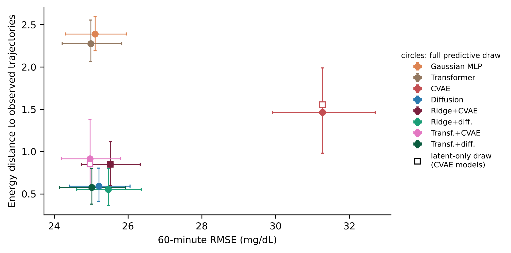
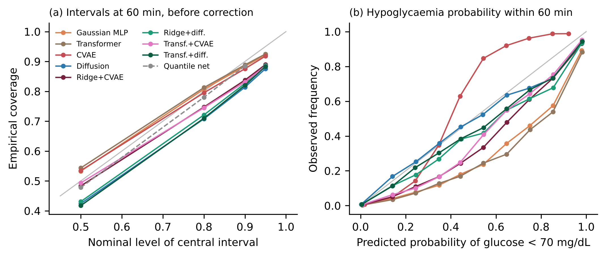
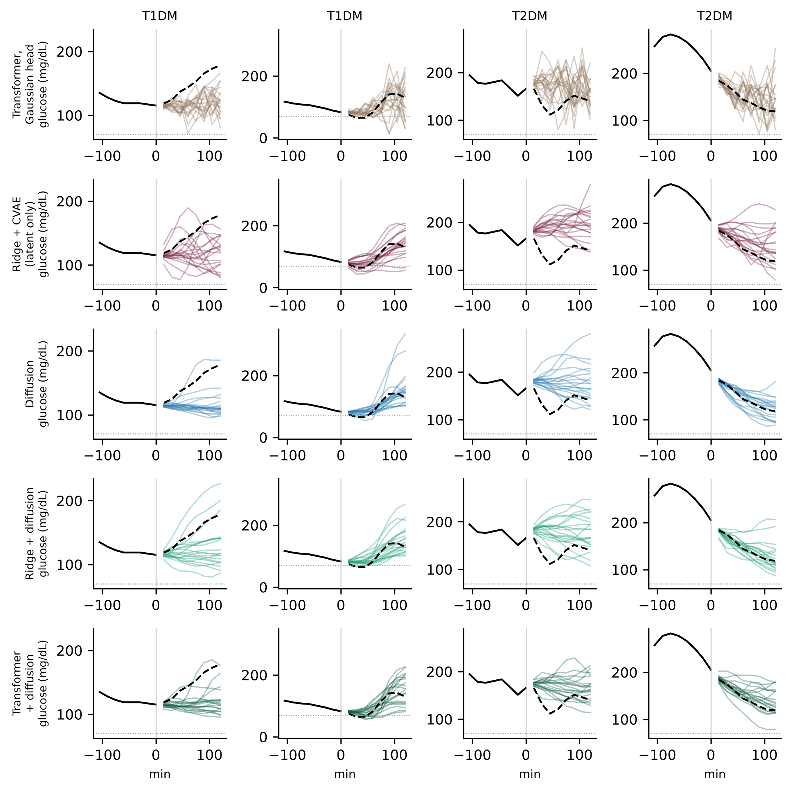

# GenAI_DT_Glucose

Code, results and manuscript source for **"Generative Digital Twins for Glucose Forecasting: A Reproducible Benchmark against Transformer and Diffusion Models on Real Patient Data"** (Akash Ghosh, Centre for AI and Machine Learning, Indian Statistical Institute, Kolkata; prepared for *MDPI Computers*).

A patient digital twin is often described as a generative model that can show many plausible futures for one person. Twin papers tend to claim more than they measure, so this repository tests those claims on real continuous glucose monitoring (CGM) records and keeps every number reproducible.

## What is in the study

- **Data:** ShanghaiT1DM and ShanghaiT2DM (Zhao et al., *Scientific Data* 2023): 112 patients, 125 records, CGM every 15 minutes with insulin and meal entries. Not copied here; see `data/README.md`.
- **Task:** forecast the next two hours of glucose from the previous two hours plus the insulin and meals recorded in the forecast window, and sample plausible trajectories.
- **Models (13):** ridge regression, GRU, Gaussian MLP, Transformer with a Gaussian head, quantile network with conformalised quantile regression (CQR), CVAE twin, diffusion twin, and hybrid twins that pair a base model (ridge or Transformer) with a generator (CVAE or diffusion) for the residual. Persistence and an MLP are in the core study.
- **Protocol:** whole patients go to train, validation or test (60/20/20, stratified by diabetes type); 8 random splits; bootstrap intervals and Wilcoxon tests across splits.
- **Measured:** accuracy at 30/60/120 min, Clarke error grid, CRPS, interval score and coverage (raw, pooled split-conformal and per-type Mondrian conformal), hypoglycaemia AUROC/Brier/sensitivity at fixed specificity/calibration, scenario realism, per-patient adaptation, 4-client federated training, int8 and distillation, subgroup and glycaemic-range breakdowns, input ablations, training-set size, latency.

## Results at a glance

Mean over 8 patient-level splits (seeds 0-7). RMSE, CRPS and interval score in mg/dL.

| Model | RMSE 60 | CRPS 60 | Interval score (conformal) | Coverage | AUROC hypo | Brier hypo | ECE hypo | Energy dist. | Latency (ms) |
|---|---|---|---|---|---|---|---|---|---|
| Ridge regression | 25.4 | – | – | – | 0.969 | – | – | – | 0.05 |
| GRU | 24.7 | – | – | – | 0.968 | – | – | – | 0.42 |
| Gaussian MLP | 25.1 | 12.9 | 106.5 | 0.911 | 0.971 | 0.022 | 0.029 | 2.39 | 0.18 |
| Transformer, Gaussian head | 25.0 | 12.7 | 105.2 | 0.911 | 0.975 | 0.022 | 0.030 | 2.28 | 0.60 |
| Quantile network + CQR | 24.8 | – | 101.9 | 0.895 | 0.941 | – | – | – | 0.11 |
| CVAE twin | 31.3 | 16.6 | 143.4 | 0.907 | 0.934 | 0.023 | 0.028 | 1.46 | 0.21 |
| Diffusion twin | 25.2 | 12.8 | 107.1 | 0.908 | 0.954 | 0.016 | 0.008 | 0.59 | 4.68 |
| Ridge + CVAE | 25.5 | 13.4 | 117.4 | 0.905 | 0.961 | 0.019 | 0.019 | 0.85 | 0.34 |
| Ridge + diffusion | 25.5 | 13.0 | 110.8 | 0.907 | 0.959 | 0.016 | 0.007 | 0.55 | 4.76 |
| Transformer + CVAE | 25.0 | 13.0 | 115.3 | 0.904 | 0.956 | 0.019 | 0.016 | 0.92 | 0.88 |
| Transformer + diffusion | 25.0 | 12.8 | 109.2 | 0.907 | 0.954 | 0.017 | 0.006 | 0.58 | 5.27 |

Values are means over splits; the paper reports bootstrap intervals and per-split counts. Reading the table:

- Ridge regression, the GRU, the Gaussian MLP, the Transformer and the quantile network sit within 0.7 mg/dL of each other at 60 minutes.
- The plain CVAE twin is the odd one out (31.3 mg/dL). The diffusion twin, with no linear base, is not (25.2), so the accuracy penalty comes from the CVAE and not from generative twins as a class.
- Gaussian-head samples zigzag from step to step, while diffusion samples are smooth and about four times closer to real trajectories in energy distance.
- For hypoglycaemia the Transformer ranks best (AUROC) and the diffusion models give the better probabilities (Brier score, ECE).
- Raw 90% intervals under-cover for every model; split-conformal correction fixes the average but type 1 patients stay under-covered. The code now also computes per-type (Mondrian) conformal intervals, which calibrate type 1 and type 2 separately; their numbers appear in `results/summary.md` after the benchmark is rerun (see *Changes since the submitted version*).
- Adapting to a new patient, federated averaging for dissimilar clients and int8 quantisation did not give the gains that twin proposals usually claim (details in the paper).






## Reproducing

```bash
pip install -r requirements.txt
# put the Shanghai files into data/ (see data/README.md)
make test          # 20 unit tests and a synthetic end-to-end smoke test, about 10 s
make quick         # 2-epoch pass of the extended benchmark on the real data
make experiments   # full study, 8 seeds; several hours on 2 CPU cores
make summary       # headline table as results/summary.md
make paper         # tables, figures and main.tex from results/*.json (needs the manuscript files, see below)
```

CPU only; no GPU is used. Seeds are fixed, and the result files in `results/` are the single source of truth for the manuscript. No number in the paper is typed by hand: `paper1/paper/fill_p1.py` writes them from the JSON files and stops if a reference or placeholder is missing.

## Layout

```
genai_dt/         shared library: windowing constants, CVAE twin, baselines, federated training
realdata/         loader for the Shanghai records (15-minute grid, glucose/insulin/meal channels)
paper1/           experiments
  p1_experiments.py   core study: accuracy, probabilistic quality, hypoglycaemia, realism,
                      adaptation, federated training, edge compression
  p1_hybrid.py        hybrid twin (ridge + CVAE residual)
  p1_advanced.py      Transformer, diffusion, CQR, base x generator hybrids, subgroup and
                      calibration analyses, ablations, training-set size
  latency_bench.py    latency and parameter counts on an idle CPU thread
  windowing.py        windows and patient-level splits
  summarise.py        headline table (Markdown) from the result files
paper1/paper/     table, figure and LaTeX-assembly scripts and references; the manuscript text itself is not
                  published here (it is held back until after the journal's similarity check)
results/          JSON results and logs of every run, summary.md and three key figures
tests/            unit tests and a smoke test
```

## Changes since the submitted version

- **Per-type (Mondrian) conformal intervals.** `p1_advanced.py` now stores, next to the pooled split-conformal interval
  (`interval_conf`), an interval whose correction is computed separately for type 1 and type 2 validation windows
  (`interval_mondrian`, with `Q_T1DM`, `Q_T2DM` and the number of validation windows per type). This targets the one
  calibration failure the benchmark reports: type 1 patients stay under-covered after pooled correction. The result
  files in `results/` predate this change and do not contain the new key. Rerun `make experiments` (or at least
  `paper1/p1_advanced.py`) on the real data, then `make summary`, which adds a pooled-vs-Mondrian coverage table.
  Only about two or three type 1 patients fall in each validation split, so the per-type correction rests on few
  patients even though it uses many windows. Report it with that caveat.
- `.gitignore` no longer hides the run logs in `results/`.

## Companion paper

The same author's second study, *When a Digital Twin Should Decline to Answer: Treatment-Effect Validity and
Calibrated Abstention in Generative Digital Twins* (Ghosh and Dalui; code in the separate repository
`GenAI_DT_Decline`), asks a different question. This benchmark compares forecasters and asks how accurate and how
well calibrated they are. The companion paper asks whether a generative twin learns the causal effect of insulin and
whether it can be trusted to choose doses. It works mainly in simulation, where the true effect is known, and it uses
the Shanghai records only to check direction of effect, action support and coverage. The two papers share the data
loader and the CVAE implementation. They do not share experiments, tables or figures.

## Limits worth knowing

Only 12 patients have type 1 diabetes, all splits draw on one pool of 112 patients, and there is no external validation cohort yet. Meals carry no carbohydrate amounts. The neural baselines are small and were not tuned beyond a fixed recipe. The twin forecasts glucose given the insulin and meals that were actually recorded; it has not been evaluated for choosing doses and must not be used that way. This is research code and not a medical device.

## Use of AI tools

Claude (Anthropic) helped write and debug the code, run the experiments and edit the text. The author reviewed the output and is responsible for it. The same statement appears in the manuscript.

## Licence and citation

Code: MIT (`LICENSE`). The Shanghai data keep their own CC BY 4.0 licence and must be cited as Zhao et al. (2023). Citation metadata is in `CITATION.cff`.
